<p align="center">
  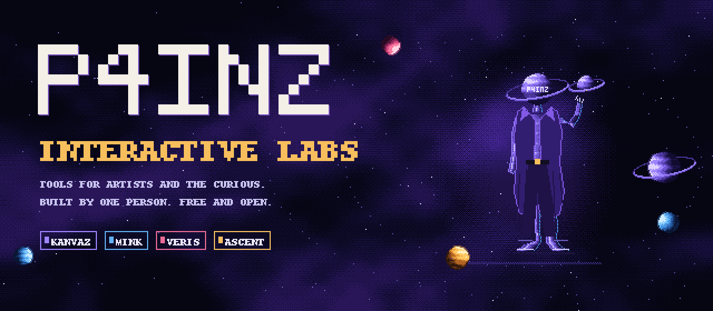
</p>

<p align="center">
  <a href="https://github.com/p4inz-code?tab=followers"></a>
  <a href="https://github.com/p4inz-code/kanvaz/releases/latest"></a>
  <a href="https://github.com/p4inz-code/kanvaz/releases"></a>
  <a href="https://github.com/p4inz-code/kanvaz/stargazers"></a>
</p>

I build software for the gaps I keep running into: the space between free and premium tools, between powerful and usable, between private and convenient. Most of what is below started as one question, "what is missing?", and a few evenings of not finding the answer elsewhere. Pick any card to open its repo.

## Start with Kanvaz

<p align="center">
  <a href="https://github.com/p4inz-code/kanvaz"></a>
</p>

The project most people find me through. A reference board for VFX, 3D and concept artists that never needs an account or a connection: 3D models, images, video, audio and notes on one canvas, linked together and kept on your own machine.

[Download](https://github.com/p4inz-code/kanvaz/releases/latest) | [User guide](https://p4inz-code.github.io/kanvaz/guide/) | [Changelog](https://github.com/p4inz-code/kanvaz/blob/main/CHANGELOG.md) | [Discord](https://discord.gg/8UKt8s5FbW)

## More tools for artists

<table>
<tr><td><a href="https://github.com/p4inz-code/Draft">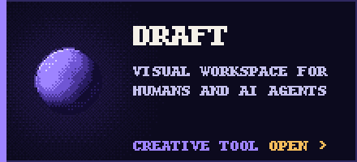</a></td><td><a href="https://github.com/p4inz-code/3d-ref-skills">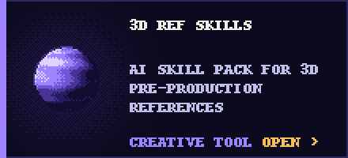</a></td></tr>
<tr><td><a href="https://github.com/p4inz-code/reference-engineering">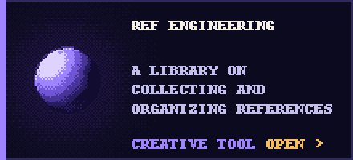</a></td></tr>
</table>

## Developer tools and apps

<table>
<tr><td><a href="https://github.com/p4inz-code/mink">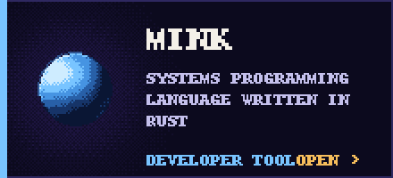</a></td><td><a href="https://github.com/p4inz-code/repo-map">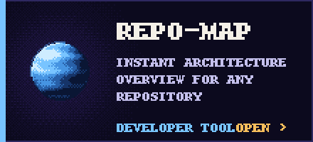</a></td></tr>
<tr><td><a href="https://github.com/p4inz-code/obscura">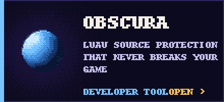</a></td><td><a href="https://github.com/p4inz-code/docflow">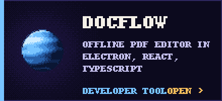</a></td></tr>
<tr><td><a href="https://github.com/p4inz-code/Crossport">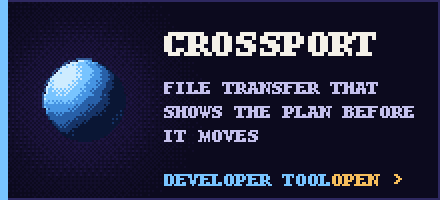</a></td></tr>
</table>

## Security and systems

<table>
<tr><td><a href="https://github.com/p4inz-code/veris">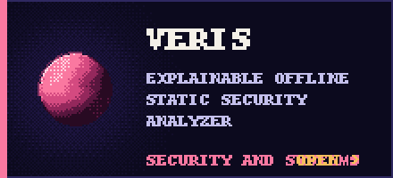</a></td><td><a href="https://github.com/p4inz-code/nexus-desktop">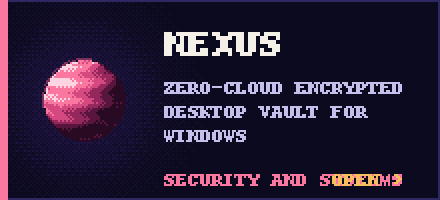</a></td></tr>
<tr><td><a href="https://github.com/p4inz-code/pursue-os">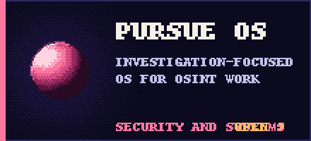</a></td><td><a href="https://github.com/p4inz-code/mission-os">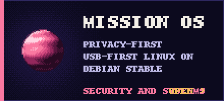</a></td></tr>
</table>

## A game

<table>
<tr><td><a href="https://github.com/p4inz-code/project-ascent">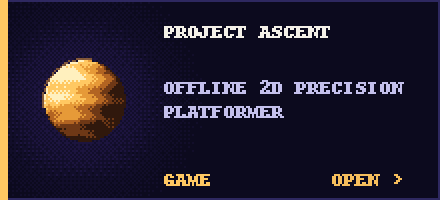</a></td></tr>
</table>

## The whole system at a glance

<p align="center">
  
</p>

## How a project gets built

```text
research -> architecture -> specification -> implementation -> testing -> audit -> documentation -> release
```

I would rather ship late with strong foundations than ship fast and rewrite. The aim is software you can still read, maintain and trust long after the first release.

## What I hold to

- Privacy by design, and security before convenience.
- Quality over feature counts.
- Simple on the surface without giving up capability.
- Documentation is part of engineering.
- Build for people, not metrics.

I also work in 3D art, VFX, game development and interface design. Those fields shape how I build software, mostly by making me care about how a tool feels in the hands of the person using it.

## Find me

| | |
|---|---|
| Website | [atharvapatil.tech](https://atharvapatil.tech) |
| GitHub | [@p4inz-code](https://github.com/p4inz-code) |
| Instagram | [@atharva.patil.cg](https://instagram.com/atharva.patil.cg) |
| Discord | [P4inz Interactive Labs](https://discord.gg/8UKt8s5FbW) |

---

<!-- SUPPORT-BLOCK:START -->
<div align="center">

### Support my work

I make these tools on my own and keep them free. If one helped you, you can chip in by UPI. Any amount.

<a href="https://p4inz-code.github.io/donate/"></a>

`9321614988@jio`

On your phone? [Open the donation page](https://p4inz-code.github.io/donate/).

Outside India, or prefer a card?

<a href="https://buymeacoffee.com/p4inz"></a>

</div>
<!-- SUPPORT-BLOCK:END -->
