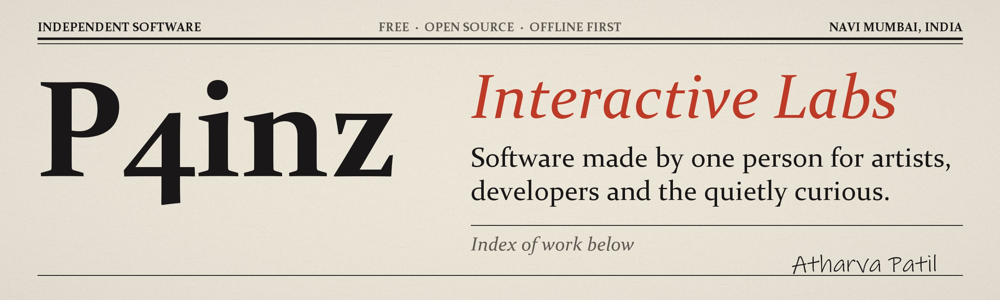

<p align="center">
  
</p>

<p align="center">
  <a href="https://github.com/p4inz-code?tab=followers"></a>
  <a href="https://github.com/p4inz-code/kanvaz/releases/latest"></a>
  <a href="https://github.com/p4inz-code/kanvaz/releases"></a>
  <a href="https://github.com/p4inz-code/kanvaz/stargazers"></a>
  <a href="https://github.com/p4inz-code/kanvaz-mini/releases/latest"></a>
</p>

Hi, I'm Atharva. I'm a solo developer and 3D artist in Navi Mumbai, and I make free, offline software for artists and developers. The main ones are a reference board, an operating system, a programming language and a game. Everything here is open source, none of it needs an account, and most of it never touches the network.

## Start with Kanvaz

<a href="https://github.com/p4inz-code/kanvaz"></a>

Kanvaz is a reference board for VFX, 3D and concept artists. Drop in images, video, audio, 3D models, PDFs and notes, wire them together in Map View, and keep it all on your own machine. It opens PureRef boards, and it can stay on top of your other windows while you work. It is the project most people find me through.

If all you need is a few pictures beside your canvas, [Kanvaz Mini](https://github.com/p4inz-code/kanvaz-mini) is the small version: one window that floats on top, opens in a second, and can pull the main colors out of a picture.

[Download](https://github.com/p4inz-code/kanvaz/releases/latest) | [User guide](https://p4inz-code.github.io/kanvaz/guide/) | [Changelog](https://github.com/p4inz-code/kanvaz/blob/main/CHANGELOG.md) | [Discord](https://discord.gg/8UKt8s5FbW)

## Recently shipped

- Kanvaz 9.8.4 (10 November 2026): Electron 45, dependency updates, and a rebuilt guide site with search, screenshots and a page linking all my projects.
- Kanvaz Mini 0.2.0 (10 November 2026): lighter colors, a palette tool, composition guides, PNG export, and a stricter security model.
- Kanvaz Mini 0.1.0 (29 October 2026): the first release, as a separate app from Kanvaz.

## Main projects

| Project | What it is | Status |
|---|---|---|
| [Kanvaz](https://github.com/p4inz-code/kanvaz) | Free, offline reference board for VFX and 3D artists | Stable, on version 9.8, Windows, macOS and Linux |
| [MINK](https://github.com/p4inz-code/mink) | General-purpose programming language written in Rust | Windows x64 only for now, published on npm |
| [PURSUE OS](https://github.com/p4inz-code/pursue-os) | Investigation-focused OS for OSINT and digital investigations | V1 beta. Development is complete, hardware testing is still in progress |
| [Project Ascent](https://github.com/p4inz-code/project-ascent) | Offline 2D precision platformer, 25 levels | Playable, pre-1.0 (v0.14.1) |
| [outlinedesk](https://github.com/p4inz-code/outlinedesk) | Offline production planner for animation, VFX and game studios | Release candidate for Windows and Linux. The source is private, so the repo holds downloads and guides |
| [Reference Engineering](https://github.com/p4inz-code/reference-engineering) | A written method for collecting and organizing references | A document library, not an app |

<details>
<summary>More projects</summary>

<br>

| Project | What it is |
|---|---|
| [Kanvaz Mini](https://github.com/p4inz-code/kanvaz-mini) | The quick version of Kanvaz: a small always-on-top reference window |
| [Draft](https://github.com/p4inz-code/Draft) | Visual workspace for humans and AI agents |
| [3D Ref Skills](https://github.com/p4inz-code/3d-ref-skills) | AI skill pack for 3D pre-production reference workflows |
| [repo-map](https://github.com/p4inz-code/repo-map) | Architecture overviews for any code repository |
| [Obscura](https://github.com/p4inz-code/obscura) | Luau source protection toolkit |
| [Crossport](https://github.com/p4inz-code/Crossport) | File transfer that shows the plan before anything moves |
| [VERIS](https://github.com/p4inz-code/veris) | Explainable, offline-first static security analyzer |
| [Nexus](https://github.com/p4inz-code/nexus-desktop) | Zero-cloud encrypted desktop vault for Windows |
| [Mission OS](https://github.com/p4inz-code/mission-os) | Privacy-first, USB-first Linux on Debian Stable |

</details>

Browse every project by tag on the [Kanvaz guide](https://p4inz-code.github.io/kanvaz/guide/more-by-p4inz.html), or read the case studies on [my website](https://atharvapatil.tech).

## How a project gets built

```text
research -> architecture -> specification -> implementation -> testing -> audit -> documentation -> release
```

I would rather ship late with strong foundations than ship fast and rewrite. A release is not done when the build passes. It is done when I have run the real app, checked the download against its checksum, and updated the changelog.

## What I hold to

- Privacy by design. Kanvaz Mini blocks every network request, and a test checks that.
- Security before convenience. A weekly automated check lints the code and audits its dependencies.
- Documentation is part of the work. Every Kanvaz release updates the changelog, the security notes and the guide.
- Simple on the surface. Mini has no panels and nothing to set up, even though Kanvaz underneath is a large app.

I also work in 3D art, VFX, game development and interface design. Those fields shape how I build software, mostly by making me care how a tool feels in the hands of the person using it.

## Find me

| | |
|---|---|
| Website | [atharvapatil.tech](https://atharvapatil.tech) |
| GitHub | [@p4inz-code](https://github.com/p4inz-code) |
| LinkedIn | [in/p4inz](https://www.linkedin.com/in/p4inz) |
| Instagram | [@atharva.patil.cg](https://instagram.com/atharva.patil.cg) |
| Discord | [P4inz Interactive Labs](https://discord.gg/8UKt8s5FbW) |

---

<!-- SUPPORT-BLOCK:START -->
<div align="center">

### Support my work

I make these tools on my own and keep them free. If one helped you, you can chip in by UPI. Any amount.

<a href="https://p4inz-code.github.io/donate/"></a>

`9321614988@jio`

On your phone? [Open the donation page](https://p4inz-code.github.io/donate/).

Outside India, or prefer a card?

<a href="https://buymeacoffee.com/p4inz"></a>

</div>
<!-- SUPPORT-BLOCK:END -->
